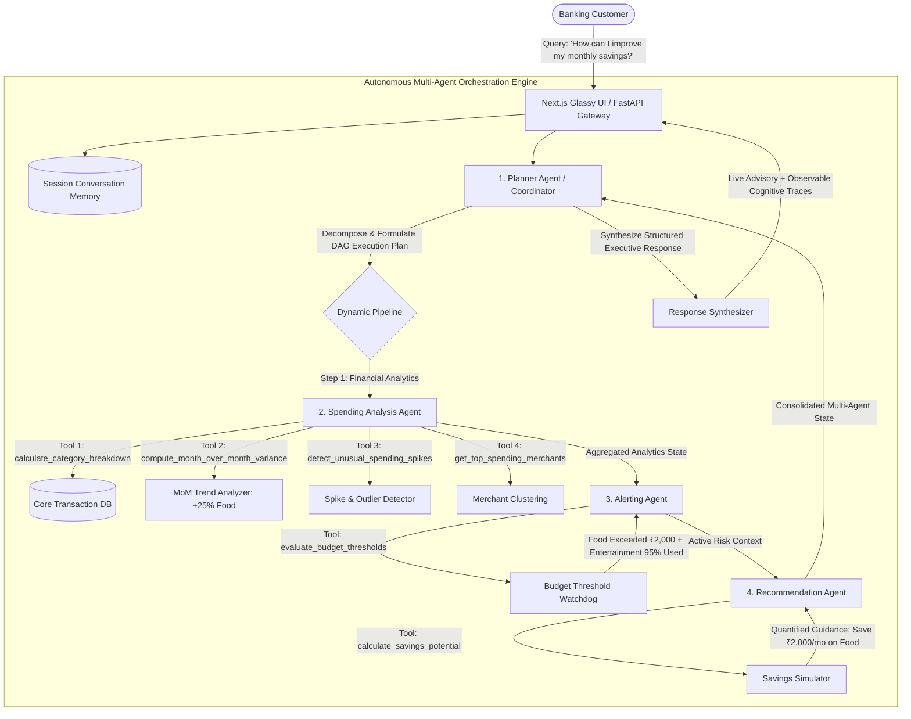

# 🏦 NexusBank Agentic AI | Retail Banking Personal Finance Advisor

> An industry-grade, multi-agent AI personal finance advisor prototype for retail banking. Built with **FastAPI**, **State-Machine Multi-Agent Orchestration (LangGraph pattern)**, and a **minimalist glassy Next.js dashboard**.

---

## 🌟 Executive Summary & Problem Understanding

Traditional retail banking applications provide static monthly statements and reactive transaction alerts that fail to offer contextual financial health insights.

This prototype demonstrates how an **Agentic AI architecture** autonomously analyzes customer transactions, evaluates multi-period spending patterns, coordinates specialized AI agents, and delivers personalized, actionable financial recommendations to the customer.

---

## 🏗️ Multi-Agent System Architecture

The solution implements a state-machine coordinator managing four specialized agents communicating over strongly-typed Pydantic schemas:



---

## 🔬 In-Depth Developed Agent: Spending Analysis Agent

As specified in the challenge guidelines, the **Spending Analysis Agent** has been developed in comprehensive architectural depth:

1. **Context Extraction & Boundary Setting:**
   - Detects the target billing cycle (`2026-10`) and baseline comparison period (`2026-09`).
2. **Categorical Aggregation (Tool Execution):**
   - Invokes `calculate_category_breakdown(month="2026-10")`.
   - Aggregates debits across all standardized banking categories:
     - **Food & Dining:** ₹12,000.00
     - **Shopping:** ₹8,000.00
     - **Travel & Commute:** ₹3,500.00
     - **Entertainment:** ₹2,850.00
     - **Bills & Utilities:** ₹5,400.00
     - **Groceries:** ₹7,600.00
     - **Healthcare:** ₹1,200.00
   - Computes net savings rate against total inflow (Salary: ₹85,000.00).
3. **Multi-Period Variance & Trend Detection (Tool Execution):**
   - Invokes `compute_month_over_month_variance(curr="2026-10", prev="2026-09")`.
   - Discovers that **Food & Dining increased by 25.0%** (from ₹9,600.00 to ₹12,000.00).
4. **Statistical Anomaly & Merchant Outlier Identification:**
   - Invokes `detect_unusual_spending_spikes(month="2026-10", single_txn_threshold=2000.0)`.
   - Flags high-value single transactions: Amazon India (₹3,800), Nature's Basket (₹3,400), Toit Brewpub (₹3,350).
   - Invokes `get_top_spending_merchants(month="2026-10", top_n=5)`.
5. **State Synthesis:**
   - Records full cognitive reasoning steps and outputs into the shared pipeline state.

---

## 🔔 Proactive Alerts & 💡 Tailored Recommendations

### Alerting Agent (Budget Watchdog)
- **High Severity Budget Exceeded:** Food & Dining spent ₹12,000 against ₹10,000 limit (120% utilized, ₹2,000 overrun).
- **Medium Severity Near-Limit Warning:** Entertainment spent ₹2,850 against ₹3,000 limit (95% utilized, only ₹150 remaining).
  > *"You are nearing your monthly entertainment budget limit."*

### Recommendation Agent (Financial Guidance)
- **Quantified Dining Curb:** *"Reducing food delivery expenses by 15% could help save approximately ₹2,000 monthly."*
- **48-Hour Cart Rule:** Applying a 48-hour cooling buffer for e-commerce purchases over ₹1,500 curbs impulse shopping by ₹1,500 monthly.
- **50/30/20 Wealth Alignment:** Auto-sweeping ₹22,000 into high-yield liquid funds boosts savings rate to over 55%.

---

## 🚀 Quickstart & Verification

### Prerequisites
- Python 3.10+
- Node.js 18+ (for Next.js frontend)

### 1. Run the Python Backend (FastAPI)
```bash
python -m uvicorn backend.app.main:app --host 127.0.0.1 --port 8000 --reload
```
Interactive Swagger API docs: `http://127.0.0.1:8000/docs`

### 2. Run the Next.js Glassy Dashboard
```bash
cd frontend
npm run dev
```
Open **[http://localhost:3000](http://localhost:3000)** in your browser.

### 3. Run the Interactive CLI Advisor
```bash
python run_advisor.py
```

### 4. Run Automated Unit Tests
```bash
python backend/app/tests/test_agents.py
```
*(All 5 test suites pass).*

---

## 📁 Repository Structure
```
├── backend/
│   ├── app/
│   │   ├── main.py                    # FastAPI REST API endpoints
│   │   ├── models/schemas.py          # Pydantic schemas for agents, tools & chat
│   │   ├── data/transaction_store.py  # Realistic multi-month banking transactions (₹)
│   │   ├── memory/conversation_memory.py # Multi-turn context & session memory
│   │   ├── tools/financial_tools.py   # Deterministic financial analysis toolset
│   │   ├── agents/
│   │   │   ├── base_agent.py          # Base Agent with trace logging
│   │   │   ├── planner_agent.py       # Central Coordinator & DAG planner
│   │   │   ├── spending_agent.py      # In-depth Spending Analysis Agent
│   │   │   ├── alerting_agent.py      # Proactive budget watchdog
│   │   │   ├── recommendation_agent.py# Actionable financial guidance
│   │   │   └── orchestrator.py        # Multi-agent state-machine pipeline
│   │   └── tests/test_agents.py       # Automated unit tests
├── frontend/                          # Next.js minimal glassy dashboard
│   ├── src/app/page.tsx               # Full dashboard + AI advisor + Savings simulator
│   └── src/app/globals.css            # Acrylic glassmorphism & ambient background
├── run_advisor.py                     # Standalone CLI interactive runner
└── submission/
    └── HACKEREARTH_SUBMISSION.md      # Submission answer formatted for HackerEarth
```
